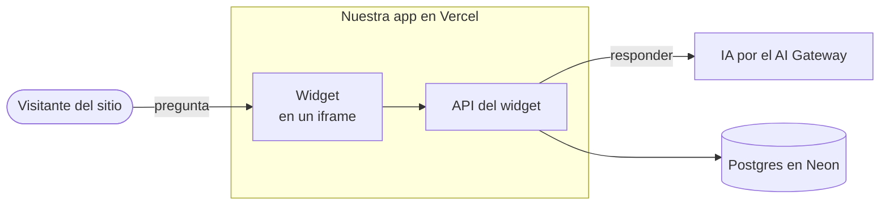

# Diagramas

En este repo, un diagrama es código Mermaid dentro del `.md` que explica la decisión:

- GitHub lo muestra en el PR y en la rama;
- se revisa en el diff;
- cualquier herramienta, o una persona, lo puede escribir y cambiar.

No se commitean imágenes sueltas que haya que mantener aparte.

## Cuándo vale la pena

- Una decisión con varias piezas que se hablan entre sí, como un ADR de arquitectura.
- Un recorrido con decisiones: qué pasa con un mensaje desde que llega.
- Un protocolo con otro sistema en el que importan el orden y los tiempos: un webhook, los reintentos, una ventana de 24 horas.
- El modelo de datos de una spec.

Si el texto alcanza, no hace falta. El diagrama acompaña al texto, no lo reemplaza.

## Qué tipo usar

| Para mostrar | Tipo de Mermaid | Cómo |
|---|---|---|
| Quién habla con quién | `flowchart LR` | Los actores a la izquierda, nuestra app en un `subgraph` y los datos y proveedores a la derecha |
| Un recorrido con decisiones | `flowchart TD` | Las decisiones, con `{"¿…?"}` |
| Un protocolo entre sistemas, en orden | `sequenceDiagram` | Para respuestas, tiempos y reintentos |
| Los estados de algo | `stateDiagram-v2` | Por ejemplo, un trabajo del taller: entró, presupuestado, aprobado, listo, entregado |
| El modelo de datos | `erDiagram` | En la spec, junto al cambio de esquema |

No uses los tipos en beta (`architecture-beta`, `block-beta`) ni la sintaxis C4 de Mermaid, porque GitHub puede no mostrarlos.

## Cómo escribirlo

- **Una idea por diagrama, con 15 nodos como máximo.** Si hace falta más, partilo en dos y decí por qué.
- **Etiquetas cortas, en español y entre comillas:** `webhook["Webhook"]`. El detalle va en las flechas o en el texto. Para cortar una línea, ` `.
- **Ids de nodo cortos, en ASCII y sin tildes:** `dueno`, `flujo`.
- **Sin datos reales:** ni nombres de clientes, ni patentes, ni teléfonos. Usá ejemplos genéricos.
- **Sin colores ni estilos propios:** GitHub muestra el diagrama en tema claro o en tema oscuro, y un color fijo se lee mal en uno de los dos.
- **Debajo de un título que diga qué muestra:** `### El recorrido de un mensaje`.

Un ejemplo, con el chat de la beta web:

## Verlo y validarlo antes del PR

Un diagrama que nadie renderizó no está terminado.

1. **Renderizalo y miralo:**
   - con la skill `diagram` de gstack, si la tenés instalada en Claude Code. Compila el Mermaid y devuelve PNG, SVG y un `.excalidraw` editable, sin conexión;
   - si no, en [mermaid.live](https://mermaid.live), que lo dibuja en el navegador.
2. **Revisá que se lea:** que ninguna flecha pase por detrás de un nodo y que no haya etiquetas encimadas.
   - El orden en que declarás los nodos y las flechas cambia dónde quedan.
   - Si una flecha cruza un nodo, reordená las declaraciones y volvé a renderizar.
3. **Mostrale el PNG al dueño** antes de commitear, si el diagrama es parte de lo que se decide.
4. **En el PR, mirá la pestaña de archivos:** GitHub muestra el diagrama o un error de sintaxis.

## Editarlo a mano

- **Para explorar ideas o mover cajas,** abrí el `.excalidraw` en [excalidraw.com](https://excalidraw.com). Es una copia de trabajo: lo que sirve se pasa de nuevo al Mermaid, que es la fuente.
- **Si un diagrama no se puede expresar en Mermaid:**
  - exportalo desde Excalidraw como SVG, con la escena incluida (*Embed scene*);
  - guardalo en `docs/diagramas/<tema>.excalidraw.svg`.

  GitHub lo muestra como imagen, y el mismo archivo se vuelve a abrir en excalidraw.com para editarlo.
