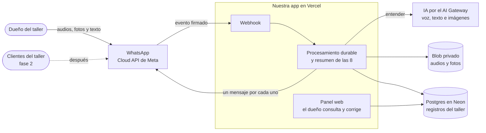
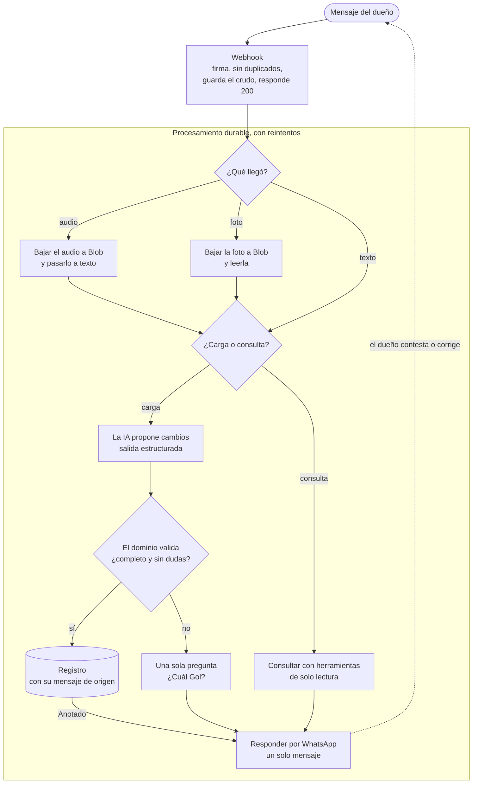
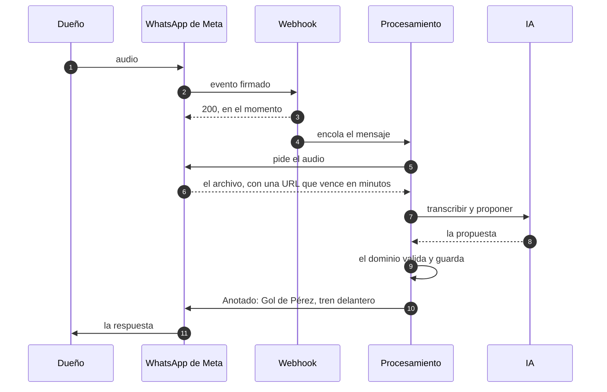

# 0102 — Arquitectura de la línea WhatsApp

- **Estado:** Propuesto. Se itera con el dueño y se ajusta con lo que salga de la [prueba a mano](../whatsapp-os/prueba-a-mano.md).
- **Fecha:** 2026-10-13
- **Relacionados:**
  - [ADR 0100](0100-linea-whatsapp-para-talleres.md): la línea.
  - [ADR 0101](0101-proveedor-de-whatsapp.md): proveedor de WhatsApp y transcripción.
  - [Inventario](../whatsapp-os/inventario.md): qué se reutiliza de la beta web.
  - La spec 100 todavía no existe: sale de la prueba a mano.

## Contexto

**Qué tiene que hacer el sistema en la fase 1** ([README de la línea](../whatsapp-os/README.md)):

- Recibir lo que el dueño cuenta por WhatsApp (audios, fotos y texto), como le sale y sin formato.
- Convertirlo en registros del taller y confirmárselo: clientes, autos, trabajos, presupuestos y cobros.
- Contestar consultas con lo que está cargado, sin inventar.
- Mandar un resumen cada mañana y mostrar todo en un panel.

**Restricciones:**

- **WhatsApp es un canal que no controlamos.** Meta puede bloquear el número o clasificar el producto como "AI Provider" (ADR 0101). El producto tiene que seguir funcionando sin WhatsApp.
- **Cada respuesta puede costar:** unos USD 0,026 desde el 1 de octubre de 2026, según proveedores. La prueba del webhook la marcó como no cobrable, y está en duda (ADR 0101). Si se cobra, un mensaje de más por cada mensaje del dueño duplica el costo.
- **Los archivos de Meta vencen:** la URL que trae el evento vence a los pocos minutos, y el media ID, a los 7 días. Con el media ID se pide una URL nueva (ADR 0101).
- **Meta reintenta el webhook** si no recibe un 200 rápido, así que el mismo evento puede llegar más de una vez. En la prueba, los reintentos llegaron en menos de 2 segundos, con el mismo cuerpo.
- **Datos de terceros:** nombres, teléfonos, patentes y la voz de los clientes del taller (Ley 25.326). Además, Meta prohíbe entrenar modelos con lo que pasa por WhatsApp.
- **Lo que cuenta el dueño es ambiguo:** "el Gol de Pérez", patentes dictadas, tres autos en un mismo audio. En el arranque de la prueba, su primer mensaje fue una foto sin texto.
- **El plan Hobby de Vercel:**
  - es solo para uso personal y no comercial ([Vercel, plan Hobby](https://vercel.com/docs/plans/hobby));
  - su cron corre como mucho una vez por día, con hasta 59 minutos de demora ([Vercel, cron](https://vercel.com/docs/cron-jobs/usage-and-pricing)). No alcanza para reintentar un audio que falló.

## Opciones consideradas

1. **Un agente con herramientas de escritura.** El modelo recibe el mensaje y escribe en la base en la misma llamada.
   - *A favor:* es lo más rápido de construir.
   - *En contra:*
     - el modelo decide qué se guarda, y sus errores pasan sin que nadie los vea;
     - una instrucción escondida en un mensaje puede escribir datos;
     - se parece al asistente conversacional que Meta prohíbe.
2. **Formularios o menús de WhatsApp** (botones, WhatsApp Flows).
   - *A favor:* datos limpios, sin errores de interpretación, y más barato.
   - *En contra:* le pide al dueño que llene algo. La prueba a mano existe justamente para ver si funciona que lo cuente como le sale.
3. **Un recorrido por etapas: la IA propone, el dominio valida y el dueño confirma.**
   - *A favor:*
     - cada etapa se prueba por separado: el dominio con tests y la IA con un eval;
     - cada dato se puede auditar;
     - cada pieza se puede cambiar: proveedor de voz, modelo o canal.
   - *En contra:* más piezas, y unos segundos más hasta la confirmación.

## Decisión

**Opción 3**, con siete reglas:

1. **El panel es el sistema de registro y WhatsApp es un canal.** Todo vive en Postgres. Si WhatsApp se cae o Meta cierra el número, los datos y el panel siguen.
2. **El webhook solo recibe:**
   - verifica la firma (`X-Hub-Signature-256`);
   - descarta los duplicados por `wamid`, con un índice único en la base. Un chequeo previo no alcanza: dos reintentos pueden llegar casi a la vez;
   - guarda el evento crudo y responde 200.

   Todo lo demás pasa en segundo plano.
3. **El procesamiento es durable.** Cada mensaje recorre sus etapas en un flujo con reintentos, no en `after()` con un cron diario.
   - Se usa [Vercel Workflow](https://vercel.com/docs/workflow). Está construido sobre [Vercel Queues](https://vercel.com/docs/queues) y suma lo que este recorrido necesita: cada paso se reintenta solo, un fallo retoma desde el último paso terminado y un paso puede esperar horas sin gastar cómputo ([guía de Vercel](https://vercel.com/kb/guide/how-to-run-background-jobs-in-nextjs-on-vercel)).
   - Queues queda para cuando haga falta mucho volumen o consumidores propios.
   - Esta regla reemplaza la parte de orquestación del ADR 0101.
4. **La IA propone, no escribe.**
   - Con salida estructurada, el modelo devuelve operaciones: crear un cliente, abrir un trabajo, registrar un cobro.
   - El dominio (`src/domain/`, código puro) valida los formatos y resuelve a qué cliente o auto se refiere.
   - Si falta un dato o hay dudas, hace una sola pregunta.
   - No hay SQL libre.
5. **Cada dato guarda de dónde salió.** Cada registro apunta al mensaje que lo originó, y la transcripción y el archivo se conservan durante un plazo. Eso permite auditar, corregir y armar el eval.
6. **Una respuesta por cada tanda de mensajes del dueño:** la confirmación ("Anotado: Gol de Pérez, tren delantero"), la respuesta a una consulta o la pregunta. Una corrección es otro mensaje del dueño: edita el registro, que guarda su historial.
   - Una tanda es lo que el dueño manda junto. Un álbum llega como varias fotos sueltas (antes, un evento `unsupported` que se ignora) y una ráfaga, como eventos separados por 1 a 4 segundos ([resultados de la prueba](../whatsapp-os/webhook-ejemplos/README.md)).
   - Cuánto se espera para cerrar una tanda se define en la spec 100.
7. **Cada paso se puede repetir sin duplicar nada.**
   - Meta puede mandar el mismo evento dos veces, y Workflow puede reintentar un paso que ya había escrito: los dos entregan "al menos una vez".
   - Por eso cada operación lleva una clave única (el `wamid` del mensaje y el número de la operación), y la base rechaza la que ya existe.
   - Así, un reintento no anota dos veces el mismo cobro.

### Quién habla con quién

### El recorrido de un mensaje

### El protocolo con Meta

El recorrido no muestra los tiempos. Con Meta, son los que más pesan:

- **El 200 sale antes de procesar nada.** Si tarda, Meta reintenta, y el mismo evento llega dos veces (regla 7).
- **El archivo se baja en el flujo, con el media ID.** La URL del evento vence en minutos, pero el media ID dura 7 días y da una URL nueva. Así, un reintento del flujo no pierde el archivo.
- **La respuesta va como texto libre** si el dueño escribió en las últimas 24 horas. Si no, solo se le puede escribir con una plantilla aprobada por Meta, como el resumen de las 8 de un lunes (ADR 0101).

### Cada pieza

| Pieza | Elección inicial | Se confirma con |
|---|---|---|
| Canal | Cloud API directa con número propio (ADR 0101) | Confirmado con el número de prueba de Meta ([ejemplos](../whatsapp-os/webhook-ejemplos/README.md)) |
| Procesamiento | Vercel Workflow, con pasos idempotentes (regla 7) | Una prueba de concepto: reintentos, tiempos y costo por mensaje |
| Voz a texto | Transcribir y después interpretar, con el vocabulario de cada taller: sus clientes, sus modelos y la jerga. Mandar el audio directo a un modelo multimodal queda como candidato | El eval con los audios de la prueba a mano (ADR 0101) |
| Separar hablantes | No en la fase 1: cada audio es del dueño, y WhatsApp dice quién escribe | Si aparecen audios reenviados de clientes |
| Texto a datos | Un modelo con salida estructurada, y el dominio que valida | Un eval de extracción: precisión por campo y que no invente |
| Fotos | Un modelo multimodal por el AI Gateway, en dos pasos: qué es (auto, presupuesto, tablero, repuesto) y qué dice (patente, montos, kilómetros) | Un eval con fotos reales. Un OCR de patentes, solo si el modelo falla |
| Consultas | Herramientas de solo lectura. Lo que no está cargado, se dice | Los casos del eval |
| Resumen de las 8 | Tarea programada: texto libre si la ventana de 24 horas está abierta y plantilla si no (ADR 0101) | — |
| Datos | Rama propia de Neon (ADR 0100) y Vercel Blob privado para audios y fotos (ADR 0011, en `develop`) | — |

### Seguridad y privacidad

- **Cada taller ve solo lo suyo** (ADR 0004). El taller sale de quién escribe y se resuelve en el servidor. Las herramientas de la IA lo reciben del contexto, nunca como un argumento que el modelo pueda inventar.
- **El dueño se identifica por su BSUID** (`from_user_id`), no por su número. Si el dueño adopta un nombre de usuario de WhatsApp, el evento llega sin el número y solo trae el BSUID ([ejemplos](../whatsapp-os/webhook-ejemplos/README.md#nombres-de-usuario)). El número se guarda cuando viene, como un dato más.
- **Un remitente desconocido** recibe una respuesta fija y no accede a ningún dato. El dueño se vincula a su taller con un código que manda por WhatsApp en el alta: así se vincula aunque oculte su número.
- **Lo que llega es un dato, no una instrucción.** Las herramientas de la IA son de solo lectura o pasan por la validación del dominio.
- **Solo proveedores que no entrenan con los datos,** con contrato de encargado y retención cero donde exista. Lo exigen Meta y la ley.
- **Retención corta:** el audio crudo se borra a los N días y queda la transcripción. N se define en la spec 100.
- **Sentry sin datos de clientes:** se suman patentes y teléfonos al filtro de `src/lib/sentry-scrub.ts`.
- **Roles:** el taller es el responsable de los datos de sus clientes, y nosotros, los encargados. Los términos y la política de privacidad se rehacen para esta línea, con revisión de un abogado.

## Consecuencias

**Lo que se gana:**

- El producto no depende de WhatsApp.
- Cada dato se puede auditar.
- Cada etapa se evalúa y se reemplaza por separado.
- El costo queda en una respuesta por cada tanda de mensajes del dueño.

**Lo que cuesta:**

- **Vercel Pro,** US$ 20 por usuario y por mes. Lo pide el uso comercial (también para la beta web), y además habilita el cron cada minuto.
- **Workflow:** en Hobby incluye 50.000 eventos por mes, y por encima cuesta US$ 0,02 cada 1.000 ([Vercel](https://vercel.com/docs/workflows/pricing)). Cuántos eventos genera un mensaje se mide en la prueba de concepto.
- **Más piezas** que un bot directo, y unos segundos de demora en cada confirmación.
- **Un proyecto más en Vercel** para la línea, con sus variables, su base y su tope de IA (ver "Lo que se resolvió").

**Lo que no cubre:**

- el proveedor de WhatsApp y el de transcripción (ADR 0101);
- el modelo de datos del taller (spec 100);
- el canal con los clientes del taller (fase 2).

**Lo que se resolvió en la segunda iteración** (13 de octubre de 2026):

1. **Workflow o Queues: Workflow** (regla 3). Antes de construir, hay que confirmar en la documentación de Vercel si ya está disponible para todos o sigue en beta. La prueba de concepto confirma los tiempos y el costo por mensaje.
2. **Que una línea no deje sin IA a la otra.** El AI Gateway admite topes de gasto por equipo, por proyecto y por API key. Al pasarse, responde 402 y no llama al modelo ([Vercel, topes](https://vercel.com/docs/ai-gateway/observability-and-spend/budgets); [changelog](https://vercel.com/changelog/ai-gateway-spend-budgets-and-alerts)). La decisión:
   - la línea WhatsApp tiene su propio proyecto en Vercel, con su tope mensual. Igual iba a necesitar variables y base propias (ADR 0100);
   - el eval usa una API key propia, con su tope;
   - el saldo prepago es uno solo para todo el equipo, y tiene que cubrir la suma de los topes. Si no, una línea igual puede dejar sin saldo a la otra, como pasó el 8 de octubre.
3. **Uno o varios números: se arranca con uno.**
   - Un portfolio de Meta sin verificar admite 2 números, y uno verificado, 20.
   - Desde octubre de 2025, el límite de mensajes es del portfolio y no de cada número. Lo dicen proveedores ([Wati](https://www.wati.io/en/blog/gcr-seo-whatsapp-business-multiple-numbers-complete-guide-to-options-limits-and-the-right-setup-2026/)), y hay que confirmarlo en la documentación de Meta ([límites](https://developers.facebook.com/documentation/business-messaging/whatsapp/throughput)).
   - Una sanción por la cláusula de IA es sobre la cuenta, no sobre un número (ADR 0101), así que alcanza a todos los números de esa cuenta. Varios números no protegen contra el riesgo principal: lo que protege es que WhatsApp sea solo un canal (regla 1).
   - El segundo número que permite Meta queda para pruebas.
   - Solo puede cambiar la decisión el cupo gratis de 1.000 mensajes: si es por número, conviene repartir los talleres desde el quinto (ADR 0101, "Antes de aceptar").
4. **Cuánto se guarda.** Es una propuesta, a confirmar con el abogado:
   - el audio crudo, 30 días; después queda la transcripción;
   - las fotos y las transcripciones, mientras exista el registro del que salieron;
   - si un taller se da de baja, todo lo suyo se borra a los 30 días;
   - para el eval, solo con consentimiento explícito, y se borra al terminar, como en la prueba a mano.

**Lo que sigue abierto:**

1. **Fotos o audios.** Si el dueño manda más fotos que audios (la primera señal de la prueba fue una foto), la foto pasa a ser el camino principal y no el secundario.
2. **Qué ve el dueño si la IA no está disponible,** por un tope de gasto o una caída del proveedor. El mensaje queda guardado y el flujo lo reintenta. Falta decidir si se le avisa y cómo, sin gastar un mensaje de más. Se define en la spec 100.
3. **El cupo gratis de Meta: por número o por cuenta** (ver el punto 3 de arriba), y si las respuestas dentro de la ventana se cobran (ADR 0101).
4. **Si Meta manda el número de un usuario con nombre de usuario** cuando ya hubo una conversación con el negocio. No cambia la regla de identificar por BSUID.

**Lo que sigue:**

1. ~~Probar el webhook con el número de prueba de Meta~~. Hecho el 14 de octubre ([guía](../whatsapp-os/prueba-webhook-meta.md), [resultados](../whatsapp-os/webhook-ejemplos/README.md)).
2. Armar vacíos los evals de transcripción, extracción y fotos, para cargar los casos apenas haya material con consentimiento.
3. Con la prueba a mano validada, escribir la spec 100.
4. Cuando la línea tenga código, el dueño crea su proyecto en Vercel, con su tope de gasto en el AI Gateway y una API key propia para el eval (punto 2 de arriba).
