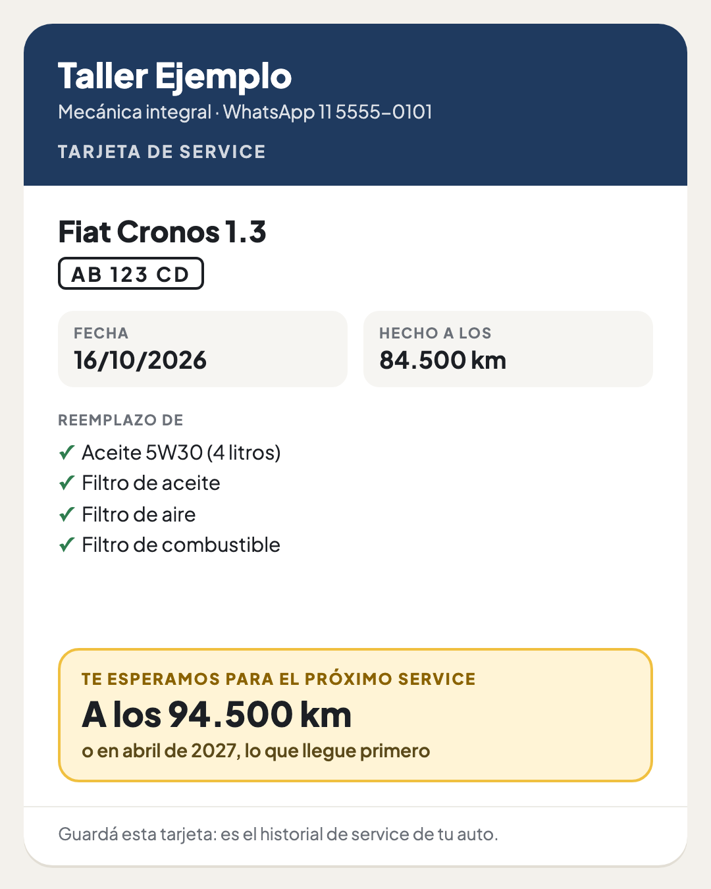

# Prueba a mano: la tarjeta de service

Después de un service o un cambio de aceite que cuenta el dueño, el sistema le devuelve una **tarjeta de service**: una imagen con el trabajo y el próximo service, para que él se la reenvíe a su cliente. Es la versión por WhatsApp de la cartulina que los lubricentros cuelgan del espejo. Se prueba a mano, como las [etapas anteriores](prueba-a-mano-segunda-etapa.md), con el primer taller.

## Por qué

- **Convierte el trabajo chico en el que más rinde.** El dueño no mandaba los cambios de aceite porque le parecían poca cosa ([resultados](prueba-a-mano-resultados.md#por-qué-no-mandaba)). Con la tarjeta, contarlos le devuelve algo que puede darle al cliente.
- **Le da algo a cambio en el momento.** Ataca la barrera de "manda y no pasa nada".
- **Arma los datos que consiguen clientes:** el km, la fecha y el próximo service. Con eso se puede decir "a este cliente le toca en diciembre", que es la palanca 5 y su dolor principal.
- **No es un hábito nuevo.** El rubro ya entrega la tarjeta en papel, y el dueño ya reenvía cosas a sus clientes: lo hizo con la publicidad del taller.
- **Nadie la ofrece así.** Los programas para lubricentros la digitalizan como link, PDF o QR, y le piden al taller que cargue los datos ([benchmark](../mercado/reports/Tarjeta%20de%20service%20para%20talleres.md)).

## Qué queremos saber

1. **¿La reenvía?** Es la señal principal: si no le sirve como para mandársela al cliente, no le sirve.
2. **¿Llegan más trabajos chicos?** Cambios de aceite y services que antes no contaba.
3. **¿Da el km?** Hoy casi nunca lo dice, y sin km la tarjeta pierde la mitad del valor.
4. **¿La pide sola** la vez siguiente, sin que se la ofrezcan?
5. **¿Qué le dice el cliente?** Solo se sabe si el dueño lo cuenta.

**Lo que no se prueba:** el recordatorio al cliente cuando le toca el service, la página con el historial del auto y la foto en la tarjeta. Vienen después, si la tarjeta engancha.

## La tarjeta

La [plantilla](tarjeta-de-service/plantilla.html) es una imagen de 1080×1350 (4:5), el formato que WhatsApp muestra sin recortar. Los campos y las palabras son los de la cartulina que usa el rubro ([cómo se ve](../mercado/reports/Tarjeta%20de%20service%20para%20talleres.md#cómo-se-ve-la-tarjeta-de-cartulina)): la marca del taller arriba, "reemplazo de" en lugar de "qué se hizo" y el próximo service como invitación, "te esperamos".

| Bloque | Qué lleva |
|---|---|
| El taller | Nombre, rubro y WhatsApp |
| El auto | Modelo y patente |
| El service | Fecha y "hecho a los … km" |
| Reemplazo de | Aceite (tipo y litros), filtros y otras piezas, una por renglón |
| Próximo service | "Te esperamos para el próximo service a los … km o en [mes y año], lo que llegue primero" |
| Pie | "Guardá esta tarjeta: es el historial de service de tu auto." |

**Reglas:**

- **El intervalo lo pone el dueño, nunca el sistema.** La primera vez se le pregunta su regla ("¿cada cuántos km y meses hacés el próximo, con este aceite?") y después se usa la misma, mostrándola en el mensaje para que la corrija.
- **Sin km, la tarjeta sale igual,** con el próximo service solo por fecha. Se anota que faltó.
- **La tarjeta lleva la marca del taller,** no la nuestra: su logo, su color principal y uno de acento ([plantilla](tarjeta-de-service/plantilla.html), tres variables y una imagen). Es lo que hace la cartulina, donde la marca ocupa todo el frente.
  - **En la prueba,** antes de la primera tarjeta se le pide por el grupo: "Mandame una foto de tu tarjeta personal o del cartel del taller". De ahí salen el nombre, los colores y los datos, y se arma la tarjeta a mano. Se le pregunta también cómo quiere que figure el nombre y qué número poner.
  - **Sin logo,** la tarjeta sale con el nombre del taller y un color neutro. No se frena por eso.

## Cómo se hace

**Antes de la primera tarjeta, una pregunta en persona o por el grupo:**

> ¿Hoy les das algo a los clientes cuando les hacés el service? ¿Una tarjetita, un sticker, les escribís?

Lo que conteste se anota. Si ya da una cartulina, la tarjeta se ofrece como complemento, no como reemplazo.

**Cada vez que cuenta un service o un cambio de aceite:**

1. **La confirmación,** con una sola pregunta, la del km si falta:

   > Anotado: Cronos, service con aceite 5W30 y filtros. ¿Con cuántos km lo entregaste?

2. **Con la respuesta, la tarjeta,** dentro de la hora, con este mensaje:

   > Te armé la tarjeta del service para que se la mandes al cliente. Puse el próximo a los 94.500 km o en abril, como me dijiste. Si querés cambiar algo, decime.

3. **No se insiste.** Si no dice nada, no se le pregunta si la mandó. Eso se pregunta una sola vez, en la charla de cierre.

**Siempre vale:**

- **Nunca se les escribe a sus clientes.** La tarjeta la manda él, desde su número.
- **Solo para service y cambio de aceite.** Si pide la tarjeta para otro trabajo, como la distribución, se la arma y se anota: es una señal.

## Cuánto dura

Arranca con el primer service o cambio de aceite que cuente el dueño después de cerrar la segunda etapa. Termina con **cinco tarjetas o cuatro semanas**, lo que llegue primero, y una charla de cierre.

## La planilla

Una pestaña nueva, **Tarjetas**, con una fila por cada tarjeta:

| Columna | Qué se anota |
|---|---|
| Fecha y hora | Cuándo se mandó la tarjeta |
| Auto (ID) | El trabajo de la pestaña **Trabajos** |
| Trabajo | Service o cambio de aceite, u otro si la pidió |
| ¿Dio el km? | Sí, solo; sí, preguntado; no |
| Demora en dar el km (min) | Desde la pregunta |
| Intervalo | El que se usó, y si lo dio él o se reusó su regla |
| ¿Pidió cambios? | Qué cambió: datos, diseño, intervalo |
| ¿La reenvió? | Sí, no o no se sabe, y cómo se supo |
| Reacción del cliente | Lo que cuente el dueño |
| ¿La pidió solo? | Si la vez siguiente la pidió sin que se la ofrezcan |

## Qué medir y cuándo vale

| Señal | Valida | No valida |
|---|---|---|
| Tarjetas que reenvía | La mayoría | Ninguna |
| La pide solo | Al menos una vez | Nunca |
| Services y cambios de aceite que cuenta | Más que antes, también en días comunes | Igual que antes |
| Da el km | Casi siempre, aunque sea preguntado | No lo sabe o no lo anota |
| Pide cambios a la tarjeta | La hace suya: el nombre, el diseño, la regla | — |
| La charla de cierre | "A los clientes les gustó", o la pide para otros trabajos | "No la mandé", "es una cosa más" |

**Lo que se aprende aunque no valide:**

- qué hace hoy con sus clientes después del service;
- si el km es un dato que tiene a mano;
- qué parte de la tarjeta le importa: el diseño con su marca, el próximo service o el registro.

## Cuidados

- **Una persona conocida del otro lado.** Igual que en las etapas anteriores, se separa el efecto de la tarjeta del efecto de que le escriba alguien conocido: misma voz y mensajes según el modelo.
- **Lo que costaría en el producto.** La tarjeta va como respuesta a un mensaje del dueño, dentro de las 24 horas, así que no necesita plantilla paga ([ADR 0101](../adr/0101-proveedor-de-whatsapp.md)). Generar la imagen cuesta poco.
- **Privacidad.** La tarjeta lleva la patente y el auto de su cliente, y va del dueño a ese cliente. En el repo solo hay tarjetas con datos ficticios.

## Después

Si valida, la tarjeta pasa a la spec 100 como una salida del sistema, con tres variantes para probar:

- **la foto del auto** que el dueño ya manda;
- **el recordatorio:** cuando le toca, el sistema le avisa al dueño y le arma el mensaje para el cliente;
- **el historial,** una página por auto que junte las tarjetas: el "librito" digital, para el cliente.

**La marca del taller en el producto.** El perfil del taller (logo y colores) se configura **primero por WhatsApp**, y además en el panel web:

- **Por WhatsApp,** el sistema no pide "subí tu logo y elegí tus colores": pide **una foto de la tarjeta personal o del cartel**. De esa foto saca el nombre, los colores, el teléfono, la dirección y la lista de servicios. Después le muestra una tarjeta de ejemplo para que diga "sí" o corrija.
- **No hace falta que tenga logo.** El primer taller no tiene: su tarjeta personal es el nombre en una letra gruesa, amarillo sobre negro, con una franja dorada. Eso ya es su marca.
- **Los logos de las marcas de autos** que suelen aparecer en esas tarjetas no se usan: son marcas registradas y no son del taller.
- **El panel** sirve para retocarlo: subir otra imagen o elegir los colores a mano.

Va en ese orden porque el dueño casi no usa la web: si la marca dependiera del panel, la primera tarjeta saldría sin ella. El sistema también controla que el texto se lea sobre el color que elija.
